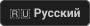
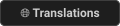

<p align="center">
  
</p>

<p align="center">
  <a href="https://github.com/LouisFahrenheit/Factorio-Control-Center/releases"></a> &nbsp;
  <a href="https://nodejs.org/"></a> &nbsp;
  <a href="LICENSE"></a> &nbsp;
  <a href="https://github.com/LouisFahrenheit/Factorio-Control-Center/wiki"></a>
</p>

Web panel for managing Factorio servers. Install on your PC or VPS - add servers and manage everything from one place.

> [!IMPORTANT]
> **Disclaimer:** Factorio Control Center is an unofficial open-source project and is not affiliated with, endorsed by, or connected to Wube Software. Factorio is a registered trademark of Wube Software Ltd.

<p align="center">
  
  
  
  
</p>

<p align="center">
  <a href="README.ru.md"></a> &nbsp;
  <a href="https://github.com/LouisFahrenheit/Factorio-Control-Center/wiki/Translating-App"></a>
</p>

<h2 id="features"></h2>

**Server**

- Start, stop, and restart
- Server log and history
- RCON console
- Server updates via the official API
- Multiple servers in one panel
- Automatic setup for a new server
- Protection against accidental updates

**Saves**

- Save management: list, upload, download, delete, rename, copy
- Built-in map generator with all in-game settings (Vanilla and Space Age)
- `.fcc` presets - export, import, and share map generator settings

**Mods**

- Enable and disable mods, change versions
- Download and update mods from the Factorio mod portal
- Upload mods from disk
- Import mods from a save
- Automatic dependency resolution
- Built-in mod settings editor
- `.fcc` modpacks - export, share, and import on another panel (you can also copy the modpack folder directly)
- Symlink support for modpacks

**Players and moderation**

- Who is online, uptime, and server stats
- Chat log and sending messages to players
- Moderation tools: kick and ban players
- Admin, ban, and whitelist lists; optionally shared across all servers
- In-game announcements

**Settings and commands**

- Edit `server-settings.json` in the UI
- Built-in RCON command catalog and editor
- Scheduled server and mod updates - weekly, with timezone support
- Shared Factorio portal username and token for all servers

**Access and UI**

- Roles: administrator, engineer, moderator - per-tab and per-server permissions
- Two-factor authentication (2FA / TOTP)
- Administrator account creation on first launch in browser or via `.env`
- Public status page with server list and mod downloads
- Full desktop UI and a simplified mobile view
- English and Russian UI
- Several themes — all dark

---

## Quick Start

Detailed installation guides, system service setup, and Docker instructions are available in the [Documentation](https://github.com/LouisFahrenheit/Factorio-Control-Center/wiki/Installation-Guide).

### Windows
1. Download [factorio-control-center-win.zip](https://github.com/LouisFahrenheit/Factorio-Control-Center/releases/latest/download/factorio-control-center-win.zip).
2. Extract the archive and launch **`Start.bat`**.
3. Select **`1. Start panel`** and open `http://127.0.0.1:8080/` in your browser.

### Linux (One-Line Installer)
```bash
bash -c "$(curl -fsSL https://raw.githubusercontent.com/LouisFahrenheit/Factorio-Control-Center/main/install.sh)"
```

### Docker
```bash
bash -c "$(curl -fsSL https://raw.githubusercontent.com/LouisFahrenheit/Factorio-Control-Center/main/install-docker.sh)"
```
