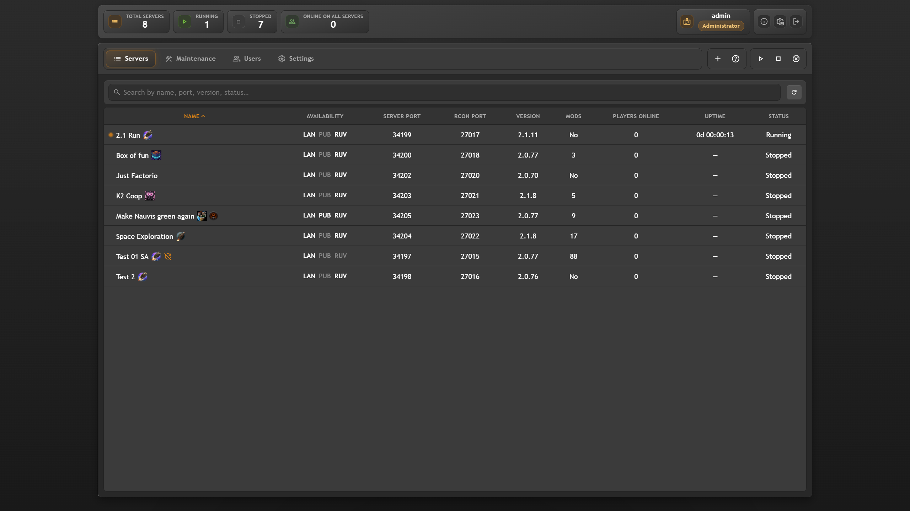
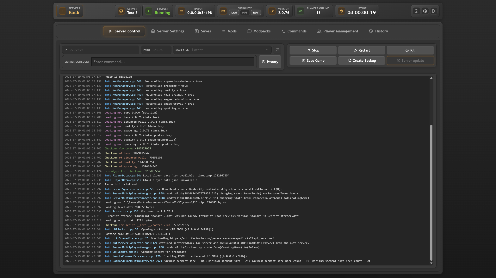
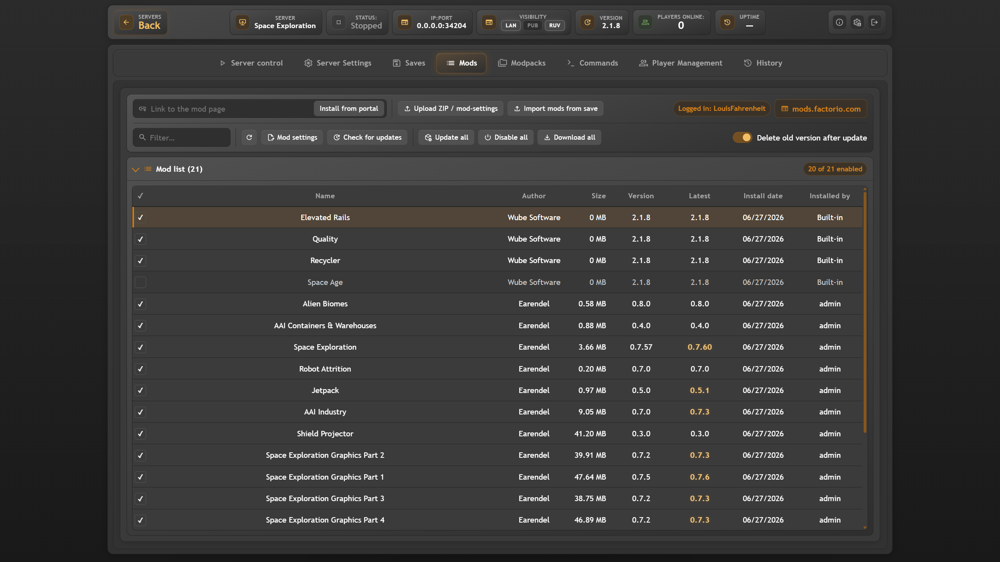
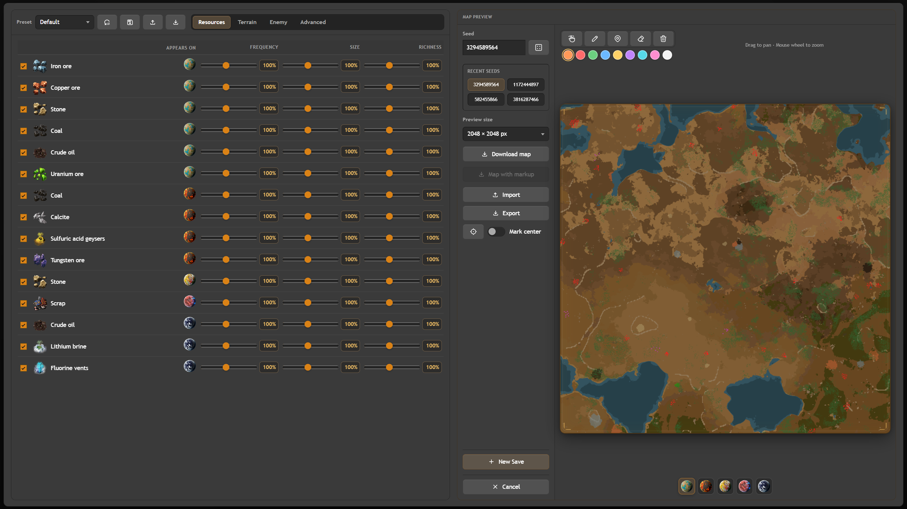

<p align="center">
  
</p>

<p align="center">
  <a href="https://github.com/LouisFahrenheit/Factorio-Control-Center/releases"></a> &nbsp;
  <a href="https://nodejs.org/"></a> &nbsp;
  <a href="LICENSE"></a> &nbsp;
  <a href="https://github.com/LouisFahrenheit/Factorio-Control-Center/wiki/Home-RU"></a>
</p>

Веб-панель для управления серверами Factorio. Ставится на ПК или VPS: добавляете серверы и управляете всем из одного места.

> [!IMPORTANT]
> **Дисклеймер:** Factorio Control Center — неофициальный open-source проект. Он не связан с Wube Software, не спонсируется и не одобрен ею. Factorio является зарегистрированным товарным знаком Wube Software Ltd.

<p align="center">
  
  
  
  
</p>

<p align="center">
  <a href="README.md"></a> &nbsp;
  <a href="https://github.com/LouisFahrenheit/Factorio-Control-Center/wiki/Translating-App-RU"></a>
</p>

<h2 id="features"></h2>

**Сервер**

- Запуск, остановка и перезапуск
- Лог сервера и история
- RCON-консоль
- Обновление сервера через официальный API
- Несколько серверов в одной панели
- Автоматическая настройка нового сервера
- Блокировка от случайных обновлений

**Сохранения**

- Управление сохранениями: список, загрузка, скачивание, удаление, переименование, копирование
- Встроенный генератор карты со всеми настройками, доступными в игре (Vanilla и Space Age)
- Пресеты `.fcc` — сохранение, экспорт и импорт настроек генератора карты

**Моды**

- Включение и отключение модов, смена версий
- Скачивание и обновление модов с портала Factorio
- Локальная загрузка модов с диска
- Импорт модов из сохранения
- Автоматическое разрешение зависимостей
- Встроенный редактор настроек модов
- Модпаки `.fcc` - экспорт, передача и импорт на другой панели (можно также просто скопировать папку модпака)
- Поддержка симлинков для модпаков 

**Игроки и модерация**

- Кто сейчас на сервере, аптайм и статистика
- Лог чата и отправка сообщений игрокам
- Модерация: кик, бан игроков
- Списки админов, банов и белых списков; опционально — общие для всех серверов
- Система объявлений на сервере

**Настройки и команды**

- Редактирование настроек сервера `server-settings.json` в интерфейсе
- Каталог готовых RCON-команд и редактор
- Обновление сервера и модов по расписанию - еженедельно, с учётом часового пояса
- Общий логин и токен портала Factorio для всех серверов

**Доступ и интерфейс**

- Роли: администратор, инженер сервера, модератор - права по вкладкам и по серверам
- Двухфакторная аутентификация (2FA / TOTP)
- Создание учетной записи админа при первом входе в браузере или через `.env`
- Публичная страница со статусом серверов и скачиванием модов
- Полноценный интерфейс на компьютере и упрощённый вид на телефоне
- Русский и английский язык интерфейса
- Несколько тем — все тёмные

---

## Быстрый старт

Подробные инструкции по установке, настройке автозапуска и развертыванию в Docker доступны в [документации](https://github.com/LouisFahrenheit/Factorio-Control-Center/wiki/Installation-Guide-RU).

### Windows
1. Скачайте [factorio-control-center-win.zip](https://github.com/LouisFahrenheit/Factorio-Control-Center/releases/latest/download/factorio-control-center-win.zip).
2. Распакуйте архив и запустите **`Start.bat`**.
3. Выберите пункт **`1. Start panel`** и откройте `http://127.0.0.1:8080/` в браузере.

### Linux (установка скриптом)
```bash
bash -c "$(curl -fsSL https://raw.githubusercontent.com/LouisFahrenheit/Factorio-Control-Center/main/install.sh)"
```

### Docker
```bash
bash -c "$(curl -fsSL https://raw.githubusercontent.com/LouisFahrenheit/Factorio-Control-Center/main/install-docker.sh)"
```
---

## Запуск для разработки

```bash
git clone https://github.com/LouisFahrenheit/Factorio-Control-Center.git
cd Factorio-Control-Center
npm install && npm install --prefix client
npm run start:dev   # API на http://127.0.0.1:8080
npm run client:dev  # UI на http://127.0.0.1:5173
```

Или запустите **`StartDEV.bat`** (Windows) / **`StartDEV.sh`** (Linux).